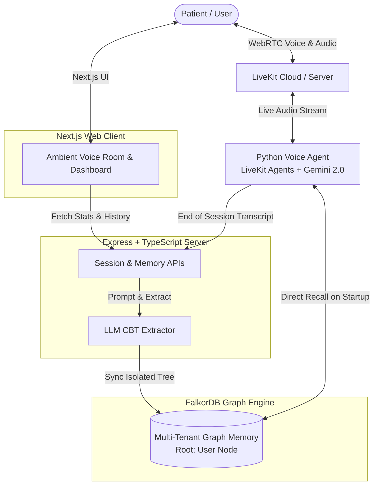

# 🧠 Hope — Autonomous AI Cognitive Behavioral Therapist

> An autonomous, multimodal voice AI therapist powered by **LiveKit Agents**, **Gemini 2.0 Flash Realtime**, and **FalkorDB Graph Memory** with strict multi-tenant clinical isolation.

---

## 🌟 Key Highlights

- 🎙️ **Ultra-Low Latency Voice Interactivity**: Sub-second conversational responses using LiveKit Agents multimodal WebRTC pipeline.
- 🧬 **4-Layer CBT Knowledge Graph Memory**: Persists episodic, semantic, and procedural clinical data in FalkorDB (Episodes, Triggers, Cognitive Distortions, Core Beliefs, Daily Practices).
- 🔒 **Multi-Tenant User Isolation**: Zero shared nodes between users; each user’s sessions and cognitive structures are anchored to an independent `User` root hub.
- 📋 **Automated Post-Session Clinical Synthesis**: Real-time LLM transcript extraction extracting CBT reframes, homework streaks, and therapist adaptation rules.
- 🎨 **Ambient Audio-Reactive Experience**: Smooth audio-reactive waveforms, intuitive transcript review, and mood progression tracking.

---

## 🏗️ System Architecture



---

## 🧠 FalkorDB 4-Layer CBT Memory Model

1. **Layer A — Coordination & History**:
   - `User` (Primary root hub)
   - `Session` (Directly linked via `[:HAS_SESSION]`)
   - `Companion` (Personalized agent personalities: Weekly, Daily, On-Demand)
   - `AgentState` (Clinical momentum, homework streaks, urgent flags)
   - `Handoff` (Inter-mode clinical transitions)

2. **Layer B — Episodic Memory**:
   - `Episode` (Situation, automatic thoughts, emotions, reframed thoughts)
   - `DailyPractice` (Completed drills, friction notes, mood deltas)

3. **Layer C — Semantic Memory**:
   - `Person` (Interpersonal relations, sentiment, roles)
   - `Trigger` (Life events & situational stressors)
   - `CognitiveDistortion` (All-or-Nothing, Mind Reading, Catastrophizing, etc.)
   - `CoreBelief` (Deep schemas: Worthlessness, Unlovability, Helplessness)

4. **Layer D — Procedural Memory**:
   - `CBTExercise` (3-Column Thought Records, Decatastrophizing, 5-4-3-2-1 Grounding)
   - `TherapistRule` (Learned conversational rules tailored to each individual)

---

## 🚀 Quickstart Guide

### Prerequisites
- Node.js 18+ & npm
- Python 3.10+
- FalkorDB instance running on `localhost:6379`
- LiveKit Cloud account / credentials

### 1. Clone & Setup Root
```bash
git clone <your-repo-url>
cd "AI Therapist"
```

### 2. Backend Setup
```bash
cd backend
cp .env.example .env
npm install
npm run dev
```

### 3. Voice Agent Setup
```bash
cd ../my-agent
cp .env.example .env.local
python -m venv venv
# Windows:
.\venv\Scripts\activate
# Linux/macOS:
source venv/bin/activate
pip install -r requirements.txt
python src/agent.py dev
```

### 4. Frontend Setup
```bash
cd ../frontend
cp .env.example .env.local
npm install
npm run dev
```

---

## 🧪 Simulation & Testing

To test multi-tenant graph memory isolation with 20 simulated clinical sessions (10 for User 1, 10 for User 2):
```bash
cd backend
npm run simulate-10
```

Verify isolation:
```bash
curl http://localhost:5000/api/memory/stats
curl http://localhost:5000/api/memory/user/sarah.miller@gmail.com/tree
curl http://localhost:5000/api/memory/user/alex.chen@yahoo.com/tree
```

---

## 📄 License
MIT License
